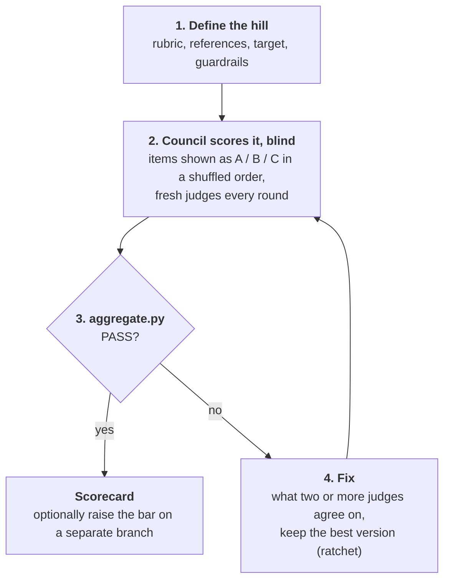

# hill-climb

An agent skill that scores anything with a blind jury of models from three different providers, then keeps improving it, round after round, until every judge rates every category 9/10 or higher and above the best examples in its category.

It works on anything you can show a judge: a UI or website, a landing page, an email, a social post, a proposal, code, a prompt or skill, a business plan. It works with any agent that supports [Agent Skills](https://agentskills.io), and it fits [T3 Code](https://github.com/pingdotgg/t3code) best, because T3 Code can reach models from three providers.

The method comes from Theo Browne's video **[Agents Sucked At UI (Until Today)](https://youtu.be/xq0eB8vxeqk)**. The jury is Theo's **`council`** skill from **[tstack](https://github.com/t3dotgg/tstack)**, included here unchanged. See [Credits](#credits).

## How it works



1. **Define the hill.** Pick a rubric (4–7 categories with anchors for 6, 8 and 10), 1–3 best-in-class references, a target (default ≥ 9.0 everywhere and ≥ the best reference), a round budget and guardrails. Anything a program can measure (tests, Lighthouse, word count, an eval set) becomes a pass/fail gate instead of an opinion.
2. **Let the council judge.** Each round is one run of the `council` skill. The judges are fresh every round and never learn the target. They see the items as A, B, C in a shuffled order without knowing which one is yours, and they score the references again in the same call.
3. **Decide with a script, not a vibe.** `scripts/aggregate.py` reads the judges' JSON and prints the round table, the per-category minimum, the gap to the best reference and `PASS` or `FAIL`. It also flags plateaus and missing judges.
4. **Fix and repeat.** Fix what two or more judges agree on, revert any round that scores lower, and show the human an annotated before and after. Stop on a pass, on the budget or on a plateau.

### What the video showed

These findings are the reason for each rule in the skill:

| Finding from the video | Rule in the skill |
|---|---|
| Judged alone, the new UI went "from 6 to 9". Next to Claude Code and Codex, the same build scored 7.4. | Always score against references. |
| The references' scores drifted (8.3 → 9.1) while their screenshots stayed the same. | Score the references again every round; trust the gap, not the raw number. |
| Theo suspected that telling judges the target ("9.5") pushed their scores. | Judges never see the target or which item is yours. |
| One judge was slow and often wrong. | Gated order (fast judge first) and advisory judges. |
| 9 → 9.5 took 10 more rounds. | Round budget, plateau stop, cost report. |
| "Too grayscale, bring the color back." | The human's taste overrides the jury. |
| An eval of real failures went 66 → 63 / 85 after one change. Later the tool descriptions were cut by 52–78% at a perfect score. | Ratchet back on any regression; two-phase climbs (quality first, then size or cost). |

## Install

You need both skills: `hill-climb` uses `council` as its jury. If you already have `council` from tstack, it's the same file, so keep yours.

### Tell your agent

The easiest way: paste this into your agent (in T3 Code, any thread works):

```text
Install the hill-climb and council skills from https://github.com/Axeeh/hill-climb.
Read the repo's AGENTS.md first and follow "If a user asked you to install these skills".
Install them for every project, then tell me what's missing to run a full jury.
```

Change "for every project" to "for this project only" if you want them in one repo. The agent installs both skills, leaves an existing `council` alone if you changed it, checks Python and the providers it can reach, and runs the sample to confirm it works.

### With the `skills` CLI

```bash
npx skills add Axeeh/hill-climb            # choose the skills and agents interactively
npx skills add Axeeh/hill-climb -g         # install for every project
```

This needs Node.js 22.20+. See [skills.sh](https://skills.sh) for the CLI.

### By hand

```bash
git clone https://github.com/Axeeh/hill-climb
cp -R hill-climb/skills/* ~/.agents/skills/
```

`~/.agents/skills/` is the shared folder most agents read. If yours loads skills from another folder, copy them there. To install them for one project only, use that project's `.agents/skills/`. If you switch between agents from different providers (as you can in T3 Code), make sure each of them can see the skills.

### Requirements

- **An agent that can run subagents on other providers' models.** [T3 Code](https://github.com/pingdotgg/t3code) does this with `delegate_task`, and `council` uses it when available. Elsewhere you need a harness that can reach three providers. With fewer providers the skill still runs, but the scorecard marks the run as degraded.
- **Python 3.9+** for `scripts/aggregate.py`. It uses only the standard library.
- A way to show the artifact to the judges: screenshots for UIs, files for text and code.

## Use it

Ask your agent:

```text
Hill climb our pricing page against Linear's and Stripe's. Score it first.
Rate this cold email out of 10 against my three best-performing ones.
Get the onboarding screen to a 9/10 from every judge. Max 5 rounds.
Build an eval for our tool descriptions, get it to 100%, then cut them to a third of the size.
```

There are two modes:

- **Score**: one round and a scorecard. Nothing is changed.
- **Climb**: the full loop. It works on a branch, a worktree or a numbered copy, never on your only copy.

Before a Climb, the agent shows you a five-line summary of the hill and waits for your OK.

### What you get

```text
hill-climb-runs/2026-11-04-pricing-page/
├── run.md              the hill, each round, decisions and rejected fixes
├── round-0/
│   ├── labels.json     which label (A/B/C) was which item this round
│   ├── claude-opus.json
│   └── gpt-sol.json
├── round-1/ …
└── scorecard.md        the summary: scores over time, the final gap to the references, what changed, cost
```

### Try the script without an agent

```bash
python skills/hill-climb/scripts/aggregate.py examples/landing-page --target 9
```

[`examples/landing-page`](examples/landing-page) is a three-round run with two references. A third judge joins in the last round, as the gated order prescribes. The script exits `0` on PASS, `1` on FAIL and `2` on bad input. Options: `--ours`, `--advisory "<judge>"` (repeatable), `--tolerance`, `--plateau`.

## Make it yours

As tstack's README suggests, keep personal settings in your agent's instructions file (usually `AGENTS.md`), not in the skill, so you can update the skill without losing them:

```markdown
## Skills
- council members: Claude Opus, GPT Sol, Gemini Pro, at high effort.
- hill-climb: default target 9.0; run logs in docs/hill-climb/; house rules (brand palette,
  tone of voice, price list) are gates.
```

Rubric presets live in [`skills/hill-climb/references/rubrics.md`](skills/hill-climb/references/rubrics.md): UI, landing page, cold email, social post, proposal, code, prompt or skill, business plan, and general writing. There are also instructions for writing your own.

## Cost and limits

- **Climbing burns tokens.** Theo's runs took about 18 hours of agent time, and what he showed cost roughly $250. Set a round budget. The skill reports the rounds and an estimated cost before it offers to raise the bar.
- **LLM judges are noisy.** The skill treats differences under 0.5 as noise, gates on the strictest judge and needs several providers to agree. A program that measures the goal is always better: build one when you can.
- **Judges converge on blandness.** That's why the loop stops at human checkpoints.

## Repository layout

```text
skills/
  hill-climb/           the skill (SKILL.md, references/, scripts/aggregate.py, agents/openai.yaml)
  council/              Theo's council skill, unchanged, with its MIT license
examples/landing-page/  a sample run for the script
tests/                  unit tests for aggregate.py (python -m unittest discover -s tests)
.claude-plugin/         plugin marketplace manifest
```

Contributions are welcome. Agents (and people) changing this repo should read [AGENTS.md](AGENTS.md) first.

## Credits

- **Method:** Theo Browne ([t3dotgg](https://github.com/t3dotgg)), from the video [Agents Sucked At UI (Until Today)](https://youtu.be/xq0eB8vxeqk) (November 2026). The council loop, scoring against competitors, the gated judge order, raising the bar from 9 to 10, and the eval-first two-phase climb all come from it. This repo turns the process into a reusable procedure.
- **`council` skill:** from [t3dotgg/tstack](https://github.com/t3dotgg/tstack) (MIT, Copyright (c) 2026 Theo Browne). Its license is in [`skills/council/LICENSE`](skills/council/LICENSE).
- The **hill-climb** skill, rubric presets, judge brief, aggregation script and tests are by [Axeeh](https://github.com/Axeeh).

This project is independent and is not affiliated with or endorsed by Theo Browne or T3.

## License

Everything except `skills/council/` is released into the public domain under [The Unlicense](LICENSE): use it, change it and ship it however you like, no attribution required.

`skills/council/` is not public domain. It keeps Theo Browne's MIT license from tstack, so copies of it must keep [`skills/council/LICENSE`](skills/council/LICENSE).
