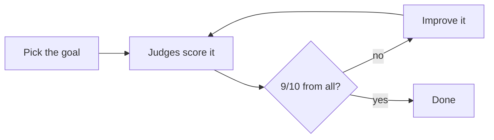

# hill-climb

An agent skill that gets a panel of AI judges from three different providers to score your work, then keeps improving it until every judge gives it at least 9/10.

It works on anything a judge can look at: a website, an email, a social post, a proposal, code, a prompt, a business plan. It runs in any agent that supports [Agent Skills](https://agentskills.io), and works best in [T3 Code](https://github.com/pingdotgg/t3code), which can reach models from all three providers.

Based on Theo Browne's video **[Agents Sucked At UI (Until Today)](https://youtu.be/xq0eB8vxeqk)**. The judges come from Theo's `council` skill ([tstack](https://github.com/t3dotgg/tstack)), included here unchanged.

## How it works



1. You choose what to judge, what "good" means and 1–3 best-in-class examples to compare against.
2. The judges score your work next to those examples, without knowing which one is yours.
3. A script adds up the scores and says pass or fail.
4. If it fails, the agent fixes what the judges agree on and tries again.

## Install

Paste this into your agent:

```text
Install the hill-climb and council skills from https://github.com/Axeeh/hill-climb.
Read the repo's AGENTS.md first and follow "If a user asked you to install these skills".
Install them for every project, then tell me what's missing to run a full jury.
```

Or do it yourself:

```bash
npx skills add Axeeh/hill-climb -g
```

You also need Python 3.9+.

## Use it

Ask your agent things like:

```text
Score our pricing page against Linear's and Stripe's.
Get this cold email to 9/10 from every judge. Max 5 rounds.
```

**Score** gives you one round of grades and changes nothing. **Climb** keeps improving until it passes, on a copy or a branch, and asks for your OK before it starts.

Climbing uses a lot of tokens, so set a maximum number of rounds.

## Credits

- Method: [Theo Browne](https://github.com/t3dotgg), from [Agents Sucked At UI (Until Today)](https://youtu.be/xq0eB8vxeqk).
- `council` skill: from [t3dotgg/tstack](https://github.com/t3dotgg/tstack), MIT license, in [`skills/council/LICENSE`](skills/council/LICENSE).

Not affiliated with Theo Browne or T3.

## License

Public domain under [The Unlicense](LICENSE), except `skills/council/`, which keeps Theo's MIT license.
